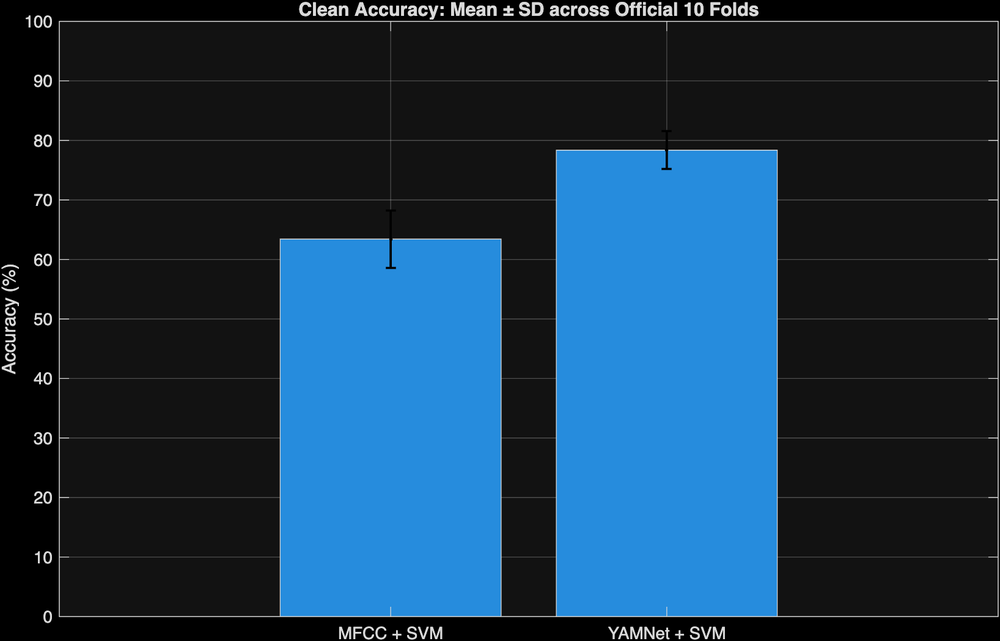
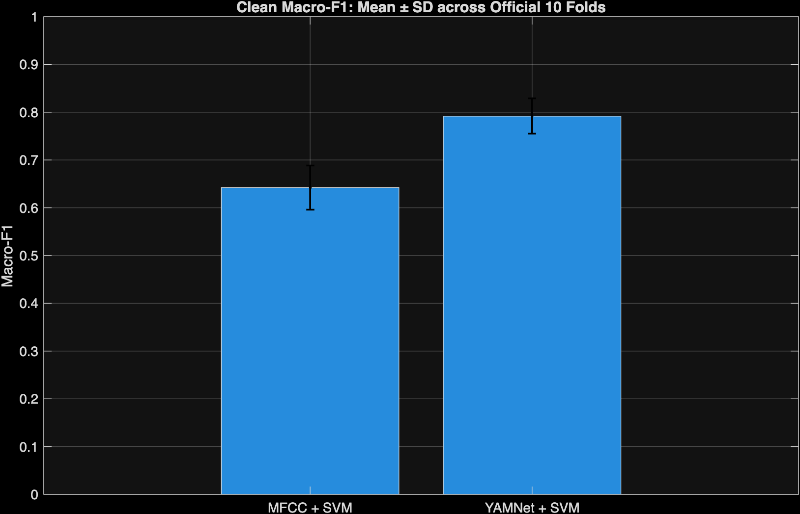
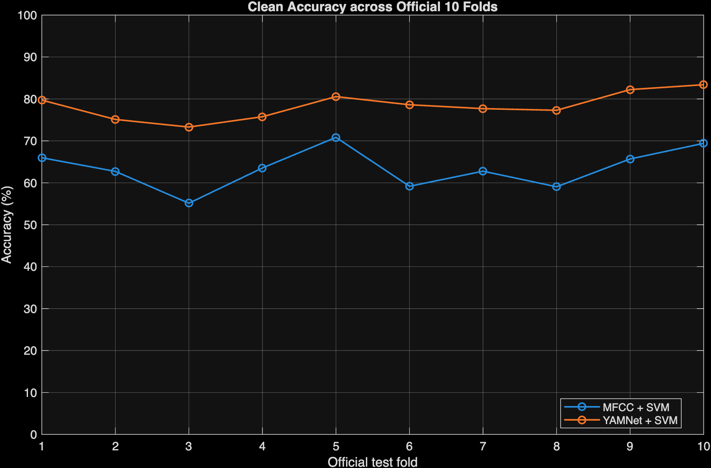
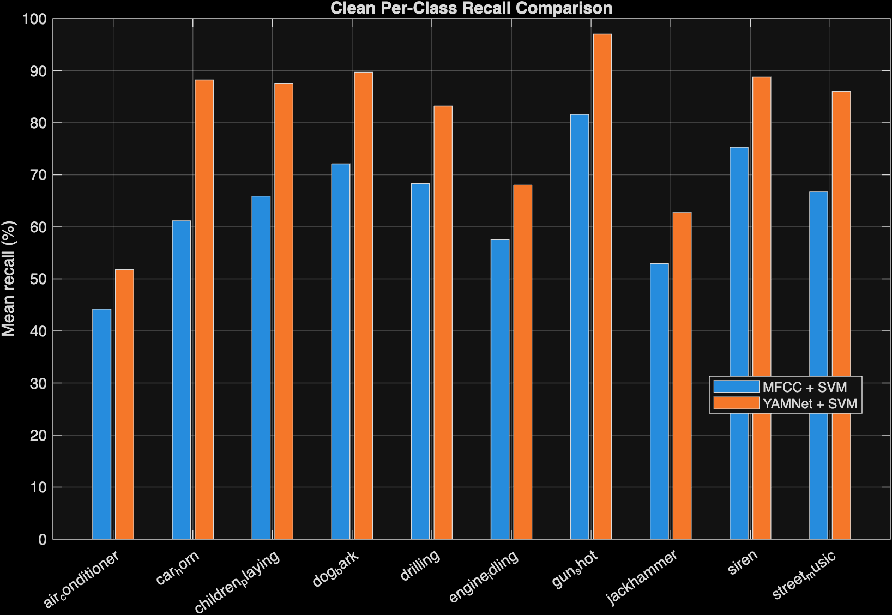

# Elec5305-project-530087661
Student: Yunzhe Shao (SID: 530087661)

**GitHub Repository:** [View Repository](https://github.com/ysha0293/elec5305-project-530087661)

**GitHub Pages:** [View Project Website](https://ysha0293.github.io/elec5305-project-530087661/)

## Project Video

[View Project Video](https://drive.google.com/file/d/1oTqImjyqKpDkdofGKj4SkjYRO1NiDER3/view?usp=drive_link)

## MFCCs versus Pretrained Audio Embeddings: Robustness of Environmental Sound Classification
This project studies the classification of the environmental sound classification based on the Urbansound8K dataset

This project initially focuses on comparing different audio features and machine learning methods by classification accuracy.

Based on the project feedback one, The main research focus of the current project has been adjusted to:

Study the robustness of different audio representation methods when the acoustic environment or recording conditions change.

The current project mainly compares:
- traditional MFCC features
- pretrained YAMNet audio embedding

These two representation methods are evaluated using a simple SVM classifier.

The project makes a comparison of the traditional MFCC feature and pretrained YAMNet embeddings with the same SVM (Support Vector Machine) classifier. The reference condition is the clean benchmark and the subsequent stages explore how noise, reverberation and channel effects affect the audio representations and the performance of the classification.

---
## Research question

### main research probelm:
**How robust are conventional MFCC features and pretrained deep audio embeddings to realistic acoustic and recording-channel perturbations in environmental sound classification?**
### secondary question:
**Can changes in the audio representation predict when classification performance will fail?**


## Dataset

This project uses the UrbanSound8K dataset.

UrbanSound8K includes:

- 8732 labeled audio segments;
- 10 environmental sound categories;
Each audio segment is approximately 4 seconds long.
- 10 pre-defined official folds.

The 10 categories are respectively:

1. Air Conditioner
2. Car Horn
3. Children Playing
4. Dog Bark
5. Drilling
6. Engine Idling
7. Gun Shot
8. Jackhammer
9. Siren
10. Street Music

The UrbanSound8K dataset can be downloaded from Zenodo:

[Download UrbanSound8K Dataset](https://zenodo.org/records/1203745)

The expected directory structure of the dataset is as follows:
```text
UrbanSound8K/
├── audio/
│ ├── fold1/
│ ├── fold2/
│ ├──...
│ └── fold10/
│
└── metadata/
    └── UrbanSound8K.csv
```
The original audio file of UrbanSound8K will not be uploaded to this GitHub.


### Background noise data

The background-noise robustness experiment in this project uses the OOFFICE environment recording from the DEMAND dataset.

The real noise document in this project has included in the Github repository, and the path is :

`asset/noise/office.wav`

Therefore, in order to reproduce this experiment, it is no necessary to download other file in the DEMAND official website (and download it and put it at the same level of UrbanSound8K dataset).

The corresponding data source and the licensing information has been placed:

- `assets/noise/README.txt`
- `assets/noise/SOURCES.csv`

All background noise robustness experiments use this fixed external environment noise recording as the noise source.


---
## The connection with ELEC 5305

This project is directly related to mutiple audio signal processing learned in the elec5305, including:

- Audio preprocessing
- Sampling and resampling
- Short-term analysis
- Window function
- Fourier spectrum analysis
- Spectrogram
- Filterbank
- MFCC
- Signal-to-Noise Ratio
- Convolution and reverberation
- Channel effect and frequency response effect

Especially during the extraction process of MFCC, This project will not merely use MFCC as a MATLAB function.

The main signal processing process of MFCC is :
```text
Audio
  ↓
Short-time frames
  ↓
Windowing
  ↓
Fourier spectrum
  ↓
Mel filterbank
  ↓
Log energies
  ↓
DCT
  ↓
MFCC
```

It can connect the environmental sound classification task with the signal processing content learned in elec5305 directly.

---
## System A：MFCC + SVM
The first system uses the traditional manual design of audio features.

Current MFCC representation includes:

- MFCC coefficients;
- First-order MFCC deltas;
- Statistical summary based on the time dimension

The extracted features use Support Vector Machine (SVM) to classify.

The purpose of this system is to provide a traditional dsp baseline with strong interpretability.

The whole process is:

```text
Audio
  ↓
Preprocessing
  ↓
MFCC extraction
  ↓
Feature statistics
  ↓
SVM
  ↓
Predicted sound class
```

---

## System B：pretrained YAMNet Embeddings + SVM

The second system uses the pretrained YAMNet model.

YAMNet is used as the frozen feature extractor in this project, instead of being trained from scratch.

The whole process is :

```text
Audio
  ↓
Pretrained YAMNet
  ↓
Audio embeddings
  ↓
Embedding statistics
  ↓
SVM
  ↓
Predicted sound class
```

MFCC and YAMNet use similar simple downstream classifiers, which can make the experiment to compare different audio representations more intensively rather than comparing the complexity of classifiers

---

## Official 10-Fold Evaluation

This project always uses the fold structure of the official urbansound8k.

Random train / test spilt will not be re-created.

In each evaluated process:

1. choose a official fold as the held-out test fold
2. the left 9 folds are used for training
3. Repeat the process for all 10 folds

The main evaluation indicators include:
- Accuracy;
- Macro-F1;
- Per-class Recall;
- Confusion Matrix;
- the average of 10 folds;
- standard deviation across the 10 folds.

Due to the fact that the difficulty of UrbanSound8K may vary among different folds, this method can avoid  the result which can only rely on one fold.

---

## Initial Clean Benchmark

Currently, I have used the official 10-fold protocol to compare clean-condition evaluation.

| Method | Mean Accuracy | Mean Macro-F1 |
|---|---:|---:|
| MFCC + SVM | **63.43 ± 4.82%** | **0.642 ± 0.047** |
| YAMNet + SVM | **78.37 ± 3.19%** | **0.792 ± 0.037** |

Current clean results indicate that the average classification performance of pretrained YAMNet embeddings is higher than MFCC featrues.

However, The main goal of this project is not to determine which method can achieve the highest clean accuracy.

The following robustness experiments further study that When the recording conditions change, whether these audio representations still maintain reliable classification performance.

---

## Clean Benchmark Figures

### Averge Accuracy



### Averge Macro-F1



###  Accuracy in Official Folds



### Per-Class Recall



---

## The robustness experiment

After building clean benchmark, the robustness of the models is evaluated under the different recording conditions.

The classifer still uses the clean UrbanSound8K audio to train.

Only held-out test recordings are gradually added to the perturbation.

MFCC and YAMNet uses the same perturbed waveform under every interference condition, which can ensure the comparison conditions between the two representation methods are consistent.


### Background Noise

Controlled environmental noise is added to the held-out test audio at three SNR levels:

- 20 dB SNR；
- 10 dB SNR；
- 0 dB SNR

The noise source is the fixed external environment noise recording in 'assets/noise/office.wav'.

### Reverberation

Add reverb to the audio through Room Impulse Response. And reverberation is achieved by convolving the held-out test audio and synthetic room impulse response.

Use three reverberation intensities:
-RT60 ≈ 0.2 seconds
-RT60 ≈ 0.5 seconds
-RT60 ≈ 0.8 seconds

### Channel / Frequency-Response Distortion

Simulate the situation where the frequency response of the microphone or recording channel changes through controlled filtering.

MFCC and YAMNet will use exactly the same perturbed waveform for feature extraction to ensure that the comparison process is strictly controlled.

Use three bandwidth conditions:
- 100–7000 Hz
- 200–5000 Hz
- 300–3400 Hz

---

## Robustness Results

### Background noise

| Condition | MFCC Macro-F1 | YAMNet Macro-F1 |
|---|---:|---:|
| Clean | 0.6423 | 0.7918 |
| 20 dB SNR | 0.6347 | 0.7914 |
| 10 dB SNR | 0.6130 | 0.7896 |
| 0 dB SNR | 0.5272 | 0.7711 |

With the noise level increases, the classification performance of two representation  decreases. MFCC is more sensitive to the background noise. Under the 0 dB SNR condition, the Macro-F1 of MFCC drops from 0.6423 to 0.5272. YAMNet drops from0.7918 to 0.7711 and its difference is smaller.


### Reverberation

| Method | Clean Macro-F1 | Strong Reverberation Macro-F1 | Performance Drop |
|---|---:|---:|---:|
| MFCC + SVM | 0.6423 | 0.5982 | 0.0441 |
| YAMNet + SVM | 0.7918 | 0.7479 | 0.0440 |

Two representation method are all affected by the reverberation. The absolute classification performance of YAMNet is still higher, but under the strongest reverberation condition, the decrease of performance is almost same comparing to the clean condition. MFCC drops by 0.0441 and YAMNet drops by 0.0440.


### Channel / Frequency-Response Distortion

| Condition | MFCC Macro-F1 | YAMNet Macro-F1 |
|---|---:|---:|
| Clean | 0.6423 | 0.7918 |
| Mild | 0.6260 | 0.7926 |
| Moderate | 0.2857 | 0.7351 |
| Strong | 0.1716 | 0.5969 |

Channel distortion is the disturbance that causes the most obvious decline in classification performance in this experiment. Under the strongest condition, the Macro-F1 of MFCC drops from 0.6423 to 0.1716, and YAMNet drops from 0.7918 to 0.5969. Therefore, under the testing channel-distortion condition in this project, the performance of the YAMNet is more stable than the MFCC.


More detail data result, category-level analysis, confusion matrix, and the correlation analysis between the representation shift and Macro-F1 degradation, please refer to the **Final Report**


---
## Robustness analysis

For each type of audio representation, we compare the clean performance with perturbed performance.

The decline in robustness can be expressed as:

```text
Robustness Drop
=
Clean Performance
-
Perturbed Performance
```

we mainly study how the classification performance changes as the degree of disturbance increases.

This project further analyses:

Which environmental sound categories are particularly sensitive to different types of disturbances.

Confusion matrices, waveforms, spectra, spectrograms and MFCC representations are used to help explain significant classification errors.

---

## Representation Change

This project also studies that:

When the category to which the sound itself belongs remains unchanged but the recording conditions change, how much has the audio representation itself changed.

For MFCC features, we can measure them by the distance between the clean feature summary and perturbed feature summary.

For YAMNet embeddings, we can use cosine distance to compare the clean representation with perturbed representation.

Then, we further compare:

```text
Representation Shift
        ↓
Classification Performance Loss
```

By simple correlation analysis, we study whether a bigger representation change is related to a bigger decrease in Macro-F1.

---

## Current progress

- [x] UrbanSound8K dataset preparation
- [x] Metadata loading
- [x] Dataset inspection
- [x] Audio preprocessing
- [x] Waveform / spectrum / spectrogram analysis
- [x] MFCC extraction
- [x] MFCC + SVM baseline
- [x] Pretrained YAMNet setup
- [x] Frozen YAMNet embedding extraction
- [x] YAMNet + SVM classification
- [x] Official 10-fold evaluation
- [x] Clean Accuracy evaluation
- [x] Clean Macro-F1 evaluation
- [x] Per-class Recall
- [x] Confusion Matrix
- [x] Mean ± Standard Deviation across folds
- [x] Reproducibility setup
- [x] Fixed random seed
- [x] Experiment manifest generation
- [x] Clip-level identifier tracking
- [x] Background-noise robustness
- [x] Reverberation robustness
- [x] Channel-distortion robustness
- [x] Representation-distance analysis
- [x] Representation-shift / performance correlation

---

## Repository Structure


```text
assets/
└── noise/
    ├── office.wav
    ├── README.txt
    └── SOURCES.csv

code/
├── main.m
├── config.m
├── test_setup.m
├── dataset/
├── features/
├── evaluation/
├── experiments/
├── perturbations/
├── analysis/
├── plots/
└── utils/

feedback/
└── ELEC5305_Project_Proposal(Yunzhe Shao-530087661).pdf

models/
└── yamnet/

results/
├── figures/
├── tables/
├── representation/
├── reproducibility/
└── robustness/

report/
└── Final project report will be added before submission.
```

`assets/noise/`  stores the external DEMAND noise recording that is used on the background noise robustness experiment.

`feedback/` stores the Project Feedback 1 corresponding  proposal file.

`models/yamnet/` stores the YAMNet model files and related supporting files used in this project.

`results/` stores the figures, table, robustness experiment results, representation-shift analysis results and the reproducibility related information produced by final experiments

`report/` stores the final report.

---

## MATLAB Requirements

Current project use the MATLAB to implement.

The project requires the following relevant functions in Toolbox:

- Audio Toolbox
- Signal Processing Toolbox
- Statistics and Machine Learning Toolbox
- Deep Learning Toolbox

At the same time, TAMNet feature extraction needs to install pretrained YAMNet support model.

The relevent MATLAB resources:

[Audio Toolbox Pretrained Models](https://www.mathworks.com/help/audio/pretrained-models.html)

[Transfer Learning with Pretrained Audio Networks](https://www.mathworks.com/help/audio/ug/transfer-learning-with-pretrained-audio-networks.html)

---
## Reproducibility

This project uses a fixed random seed and stores the main experimental settings for reproducibility.

The information in the automatically generated reproducibility manifest will include information like:

- MATLAB release;
- toolbox information;
- preprocessing settings;
- MFCC parameters;
- SVM parameters;
- YAMNet loading information.

Identifiers are also stored in the feature and prediction output files to allow for matching of clean and perturbed versions of the same recording in subsequent robustness analyses.

---

## Experimental reproduction instructions

### 1. Clone Repository

```bash
git clone https://github.com/ysha0293/elec5305-project-530087661.git
```

### 2. Download UrbanSound8K and noise dataset

Dataset download address:
[UrbanSound8K Dataset - Zenodo](https://zenodo.org/records/1203745)

After downloading and extracting the UrbanSound8K dataset, place the UrbanSound8K folder in the project root directory, at the same level as the code and results folders.

The background-noise robustness experiment in this project uses the OOFFICE environment recording from the DEMAND dataset.

The real noise document in this project has included in the Github repository, and the path is :

`asset/noise/office.wav`

Therefore, in order to reproduce this experiment, it is no necessary to download other file in the DEMAND official website (and download it and put it at the same level of UrbanSound8K dataset).

The expected structure is as follows:

```text
project/
├── assets/
│   └── noise/
│       ├── office.wav
│       ├── README.txt
│       └── SOURCES.csv
├── code/
├── models/
│   └── yamnet/
├── results/
├── UrbanSound8K/
│   ├── audio/
│   │   ├── fold1/
│   │   ├── fold2/
│   │   ├── ...
│   │   └── fold10/
│   └── metadata/
│       └── UrbanSound8K.csv
└── README.md
```

### 3. Install YAMNet Support Model

The implementation automatically checks whether pretrained YAMNet is available. If it is already available in MATLAB, it is loaded directly. Otherwise, the project loader attempts to prepare the model automatically.

we can pass the testing by following codes:

```matlab
[net,classes] = audioPretrainedNetwork("yamnet");
```

### 4. Run the Setup Check

```matlab
cd code
test_setup
```

This command will check:

- dataset paths；
- metadata；
- official folds；
- MATLAB required functions；
- YAMNet availability。

### 5. Run the full experiment

```matlab
main
```

The experiment results will be saved into:

```text
results/tables/
results/figures/
results/robustness/
results/representation/
results/reproducibility/
```

After the reproduction is successful, 'ALL CHECKS PASSED' will be appeared in the command window.


---


## Project Documents

[Project Proposal(project feedback 1) (PDF)](feedback/ELEC5305_Project_Proposal(Yunzhe%20Shao-530087661).pdf)
[Project Feedback 2 (PDF)](ELEC5305_Feedback2_Yunzhe_Shao.pdf)

## References and Resources

1. J. Salamon, C. Jacoby, and J. P. Bello,  
   *A Dataset and Taxonomy for Urban Sound Research*,  
   Proceedings of the 22nd ACM International Conference on Multimedia, 2014.  
   UrbanSound8K dataset: https://zenodo.org/records/1203745

2. K. J. Piczak,  
   *Environmental Sound Classification with Convolutional Neural Networks*,  
   2015 IEEE 25th International Workshop on Machine Learning for Signal Processing (MLSP), pp. 1–6, 2015.  
   DOI: 10.1109/MLSP.2015.7324337

3. J. F. Gemmeke, D. P. W. Ellis, D. Freedman, A. Jansen, W. Lawrence,  
   R. C. Moore, M. Plakal, and M. Ritter,  
   *Audio Set: An Ontology and Human-Labeled Dataset for Audio Events*,  
   2017 IEEE International Conference on Acoustics, Speech and Signal Processing (ICASSP), pp. 776–780, 2017.  
   DOI: 10.1109/ICASSP.2017.7952261

4. S. Srivastava, H.-H. Wu, J. Rulff, M. Fuentes, M. Cartwright,  
   C. T. Silva, A. Arora, and J. P. Bello,  
   *A Study on Robustness to Perturbations for Representations of Environmental Sound*,  
   2022 30th European Signal Processing Conference (EUSIPCO), pp. 125–129, 2022.

5. TensorFlow,  
   *Sound Classification with YAMNet*,  
   TensorFlow Hub Documentation.  
   https://www.tensorflow.org/hub/tutorials/yamnet

6. MathWorks,  
   *Audio Toolbox Pretrained Models*,  
   MATLAB Documentation.  
   https://www.mathworks.com/help/audio/pretrained-models.html

7. MathWorks,  
   *Transfer Learning with Pretrained Audio Networks*,  
   MATLAB Documentation.  
   https://www.mathworks.com/help/audio/ug/transfer-learning-with-pretrained-audio-networks.html

8. OpenL3,  
   *Open-Source Deep Audio and Image Embeddings*,  
   https://github.com/marl/openl3

